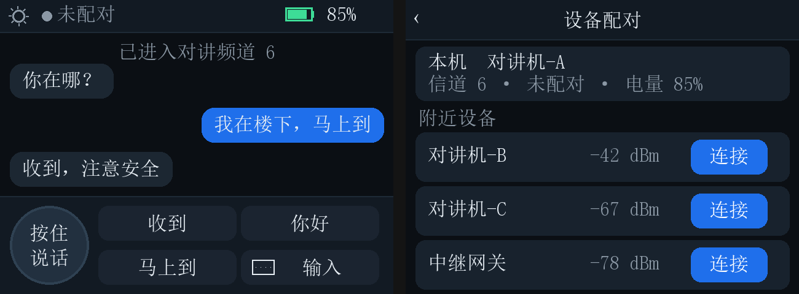

# ESP-NOW 对讲机 (Walkie-Talkie)

基于 **ESP32-S3 + LVGL** 的手持对讲机，支持 **ESP-NOW 文字聊天、PTT 语音、多跳 Mesh 中继**；
配套 **ESP8266 网页聊天节点**（手机连 AP 打开网页即可聊天）。

> A portable ESP-NOW walkie-talkie: text chat, push-to-talk voice (ESP32-S3), multi-hop mesh relay,
> plus ESP8266 web-chat nodes. Version **1.0.0**.



## 特性

- **文字聊天**：ESP32-S3 屏幕气泡对话，ESP8266 网页端同步收发
- **多跳 Mesh**：TTL + 去重，节点可自动转发 HELLO/文字，扩展覆盖范围（无需中心节点）
- **发送者名字**：每条消息显示来源节点，名字可自定义（S3 存 NVS，8266 存 EEPROM）
- **PTT 语音**：ESP32-S3 按住说话（IMA ADPCM 20ms 帧，ESP-NOW 广播），当前为单跳
- **UI**：240×320 竖屏、纯黑 + 荧光绿；大号方键 / 横屏 QWERTY 输入；设置页可调音量、亮度
- **硬件适配**：2.8" ILI9341 + FT6x36 触摸 + ES8311 音频 + 电池电量显示

## 硬件

| 设备 | 说明 |
|---|---|
| ESP32-S3 对讲机 | ES3C28P/ES3N28P 2.8" 板（16MB Flash / 8MB PSRAM，ILI9341，FT6x36，ES8311） |
| ESP8266 ×2 | Wemos D1 mini（4MB Flash），USB 供电或充电头供电 |
| 可选 | 锂电池（带保护板）+ TP4054 充电（默认约 300mA） |

详细引脚见 [docs/HARDWARE.md](docs/HARDWARE.md)。

## 架构

```
        ESP-NOW (Wi-Fi 信道 6, 广播)
 ┌──────────────┐      ┌──────────────┐      ┌──────────────┐
 │ ESP32-S3     │◄────►│ ESP8266      │◄────►│ ESP8266      │
 │ NODE-xxxx    │      │ WEB-xxxx     │      │ WEB-xxxx     │
 │ 屏幕 + PTT   │      │ 网页聊天      │      │ 网页聊天      │
 └──────────────┘      └──────────────┘      └──────────────┘
```

- ESP32-S3 与 8266 使用同一套 21 字节帧头 + CRC16 协议
- 所有节点平级；HELLO 每 3 秒广播，节点 10 秒无心跳视为离线
- 帧 `flags` 的 bit2-5 为 TTL，支持最多 3 跳中继（见 [docs/MESH.md](docs/MESH.md)）

## 快速开始

### 1. 编译 / 烧录 ESP32-S3

要求 **ESP-IDF 5.5.x**（5.5.4 验证）、Python 3.11。

```bash
# 在 ESP-IDF 终端中：
cd firmware/esp32s3
idf.py build
idf.py -p COM8 flash
```

> 请使用 **纯 ASCII 路径**（例如 `C:\Users\you\Desktop\ESPNow-WalkieTalkie`）。
> 中文路径会导致 ESP-IDF 的 kconfgen/ccache 报错。

### 2. 编译 / 烧录 ESP8266

要求 **arduino-cli** + **ESP8266 core 3.1.1**（Wemos D1 mini）。

```bash
arduino-cli compile --fqbn esp8266:esp8266:d1_mini firmware/esp8266/web_chat
arduino-cli upload -p COM14 --fqbn esp8266:esp8266:d1_mini firmware/esp8266/web_chat
```

也可以直接运行 [tools/flash_esp8266.bat](tools/flash_esp8266.bat) `COM14`。

### 3. 使用

1. 所有节点上电（同一 Wi-Fi 信道 6）
2. 手机连接 ESP8266 的 AP：**SSID `ESP-NOW-CHAT`，密码 `12345678`**
3. 浏览器打开 `http://192.168.4.1`，即可收发文字
4. ESP32-S3 端：`NODES` 页查看在线节点、改本机名字；`SETTINGS` 调音量/亮度；`TEXT` 横屏输入；`HOLD TALK` 语音

## 文档

- [docs/PROTOCOL.md](docs/PROTOCOL.md)：帧格式、flags/TTL、消息类型、语音编码
- [docs/MESH.md](docs/MESH.md)：多跳中继、去重、限流、日志说明
- [docs/HARDWARE.md](docs/HARDWARE.md)：板卡、引脚、音频、电源
- [tools/](tools/)：串口抓取与一键烧录脚本

## 已知限制

- 语音 PTT 目前**单跳**（多跳语音需要额外处理延迟/抖动）
- 固定 Wi-Fi 信道 6，ESP-NOW 广播无加密
- 节点名最长 23 字符；消息目前仅英文 UI（代码 UTF-8，可扩展）
- Mesh 中继仅覆盖 HELLO 与 TEXT

## 版本

- **v1.0.0**：首个发布版（文字聊天 + Mesh 多跳 + 语音单跳 + 设置页 + 横屏键盘）

## 许可证

本项目代码采用 **MIT License**，见 [LICENSE](LICENSE)。
第三方组件：
- [LVGL](https://github.com/lvgl/lvgl) v8.4 — MIT
- `lvgl_esp32_drivers`（Espressif / LVGL 社区）— MIT
- ES8311 驱动来自 Espressif BSP 示例 — Apache-2.0
